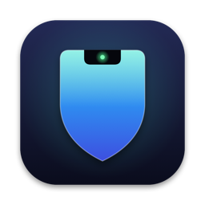

<p align="center"></p>

# NotchGuard

Your Mac's camera already sits in the notch. NotchGuard uses it to notice when you walk away and when someone else sits down.

- **Walk away** and a cover slides over your screen, then the Mac locks for real.
- **Someone else sits down** and the Mac locks right away. NotchGuard takes their photo and texts it to you over iMessage.
- **Come back** and your face unlocks it, at the cover and (optionally) at the real lock screen.
- **Lock apps** like Messages or Notes so they need your face or Touch ID to open.
- **Relax at home, tighten everywhere else.** Save places by their Wi-Fi router or location, and set strict hours.

Everything runs on your Mac. Camera frames are checked in memory and thrown away; nothing is uploaded, and there are no accounts, analytics or servers.

Requires macOS 14 or later on Apple silicon. Works on Macs without a notch too: the cover grows out of a pill at the top of the screen instead.

## Install

Download `NotchGuard-<version>.dmg` from the [latest release](../../releases/latest), drag it to Applications and open it. A setup window walks you through camera access, a one-time face model download, face setup and how strict to be.

Or build it yourself (Xcode 16 or later):

```bash
NO_BUNDLED_MODEL=1 ./build.sh   # builds build/NotchGuard.app; setup downloads the face model
open build/NotchGuard.app
```

## How strict

Pick a level during setup; change it any time in Settings.

| | Light | Balanced | Maximum |
|---|---|---|---|
| Wait before checking | 30 s | 10 s | 5 s |
| When you walk away | Cover only | Cover, then the real lock after 15 min | Real lock right away |
| Proving it's really you | Any natural movement | Any natural movement | A head turn and a blink |
| Places you haven't saved | Normal | Normal | Strict |

Someone else at your Mac locks it at every level. Lowering the level or turning protection off asks for Touch ID.

## Security model

Read this before turning on face unlock.

- **Face unlock at the lock screen needs your Mac password.** NotchGuard checks the password against your account, then stores it in your login keychain, readable only by this signed app. It's loaded into memory only after Touch ID (or your password) approves it once per session. It's typed only when the screen is actually locked, and the app checks that again right before typing. If you'd rather not, skip it: the cover still unlocks with your face, and the real lock screen works as usual.
- **Typing at the lock screen needs Accessibility access.** That's the same permission password managers use to type for you.
- **Liveness checks are not Face ID.** The camera is a regular webcam with no depth sensor. NotchGuard looks for natural movement and blinks and watches for phones and screens held up to the camera, but a determined attacker with a good video of you may get past the cover. Keep FileVault on and treat NotchGuard as a guard against casual snooping, not as your only lock.
- **Private macOS APIs.** Locking the screen uses `SACLockScreenImmediate` from login.framework, and the lock screen status display uses SkyLight. Both are loaded at runtime and fail safe if a future macOS removes them.
- **Network.** The only connections NotchGuard makes are the one-time face model download from InsightFace's GitHub release and the Messages app sending your intruder alerts.

## Face model

NotchGuard recognizes faces with InsightFace's MobileFaceNet (`w600k_mbf` from `buffalo_s`), converted to Core ML on your Mac. **InsightFace licenses these weights for non-commercial research use only**, so they aren't in this repo or in the app. The app downloads them from InsightFace's release during setup, with a link to that license. NotchGuard itself is MIT licensed, but if you build anything commercial on it, swap in a model whose license allows that.

## Command line

`plock` controls the app from Terminal: `plock status`, `plock check` (prints your match score), `plock pause` / `resume`, `plock log`, `plock enroll`, and a few test commands (`live-test`, `cover-test`, `lock-test`).

## NotchNerd

The core lives in the `PresenceKit` Swift package, which [NotchNerd](https://github.com/mkbuilds4/NotchNerd) also uses for its Guard feature.

## Credits

- Lock screen typing is adapted from [Glance](https://github.com/jonnyoo/glance) (MIT).
- Face recognition weights by [InsightFace](https://github.com/deepinsight/insightface) (non-commercial research license, downloaded separately).

## License

MIT, see [LICENSE](LICENSE). Made by [MK Builds](https://mkbuilds.dev).
